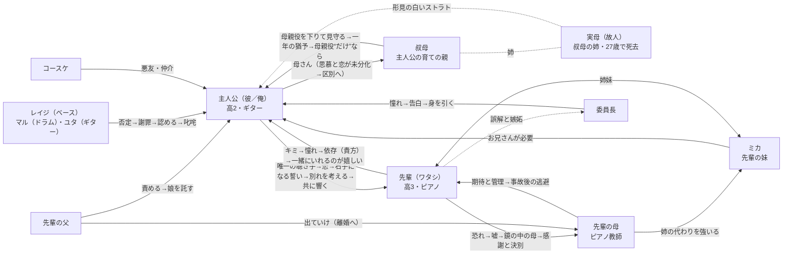

# 『キミの右手のアイロニー』ストーリーバイブル（PV制作用）

- 原作：宮本有楽『キミの右手のアイロニー』（全40話）／ `source/novel.txt`（全6,888行）
- 用途：劇場アニメ本予告（3分PV）の脚本・絵コンテ・作画・音響・台詞音声の共通参照
- 統合元：分担精読9チャンク（c1〜c9）の分析結果と `analysis/director_notes.md`。不明点・矛盾は本文を直接読んで解決した（付録A）
- 表記：「L123」は `novel.txt` の行番号。「」内の台詞は本文と一字一句同じ（第9章の40本はスクリプトで照合済み）。〔推定〕は本文に明記がなく、根拠付きで推し量ったもの
- ⚠ このファイルには結末までのネタバレが含まれる。PVで見せる範囲は第10章と、第9章の「ネタバレ度」に従うこと

**ネタバレ度の定義（第3・9・10章で共通）**

| 度 | 範囲 | PVでの扱い |
|---|---|---|
| 0 | 第1〜19話（出会い〜文化祭〜初夏） | 自由に使ってよい |
| 1 | 第20〜23話（夏・コンクール予選・夜の公園）。後半の台詞でも、文脈を伏せれば核心に触れないもの | 予感の演出に使う |
| 2 | 第24話以降の展開をほのめかすもの（事故、右手の喪失、嵐の夜、後半の葛藤） | 本数を絞り、画で断定しない |
| 3 | 核心（右手が動かないことの断定、自傷・自殺未遂の具体、家族の崩壊、回復の可能性、エピローグの正体） | PVでは使わない |

---

## 0. 1分で読む要点

- **核**：昼休みの音楽室で、孤独な天才ピアニストの「先輩」と、彼女のたった一人の聴き手になったギター少年「彼」が、音で心を通わせる。物語の中盤、事故で先輩の右手が動かなくなる。「俺が……先輩の右手になるよ」（L4192）という誓いは救いにも鎖にもなり、最後に二人は傷ごと響き合う音を見つける。
- **名前は呼ばない**：二人の本名は本文に一度も出ない（L3544・L3550「呼ばれる名前」）。PVでも「先輩」「キミ」で通す。
- **PVの問い**：「ピアノが彼女のすべてだった。」（L3809）→「俺が……先輩の右手になるよ」（L4192）。救いか、鎖か。答えは劇場に残す。
- **本命曲**：ショパン〈別れの曲〉（予選で弾いた曲を、病室で鼻歌にする。L3406、L3985–3994）と、原作最終話の「二人の曲」をもとにしたオリジナル主題曲（L6638–6648）。
- **隠すもの**：ナイフ（自傷）、手首、欄干から身を乗り出す瞬間、性的な場面、家族崩壊の具体、右手が回復する可能性、エピローグの叔母の正体。

---

## 1. 作品概要

### 1-1 ログライン
“弾かなければならない曲”しか知らなかった転入生ピアニストの先輩と、昼休みの音楽室で彼女のたった一人の聴き手になったギター少年が、音で結ばれた矢先に事故で彼女の右手を失い、“右手になる”という彼の約束が救いにも鎖にもなる日々をくぐり抜けて、傷ごと響き合う音にたどり着くまでの物語。

### 1-2 基本データ
- 舞台：高校（第二音楽室、中庭、体育館）、海辺の臨海公園と白い大橋、主人公のマンション（叔母も別室に住む）、先輩の家（防音室）、病院
- 期間：ある年の四月から翌年の八月まで、約1年4か月（第2章の早見表を参照）
- 語り：主人公（地の文の自称は「自分」、台詞の一人称は「俺」）と先輩（「ワタシ」）の一人称が、章ごと・場面ごとに交代する。ほかにレイジ（第15話前半）、委員長（第15話後半）、叔母（第33話前半とエピローグ）の視点がある
- 名前：主人公も先輩も本名は出ない（L1362、L3544、L3550、L3776）

### 1-3 テーマ
1. **「弾かなければならない曲」から「歌う音」へ**：好きな曲を持たなかった少女（L384、L778）が、自分の音で“歌う”ようになる（L859–860、L2804）
2. **聴くことは、愛すること**：野次馬が去っても残った「一人を除いて。」（L181）。拍手一つで世界が変わる（L226–236）
3. **言葉以外の言葉**：音で会話する二人（L714、L1131、L2411）。言葉は不器用でも、音は正直
4. **喪失とアイデンティティ**：自分を証明する唯一の手段を失うことは「生命の危機じゃ……ないんだろうか」（L3816–3818）
5. **救いと依存の境界**：「俺が……先輩の右手になるよ」（L4192）が、「だって、貴方が、ワタシの右手の代わりになってくれるんでしょう」（L5568）に反転する。「自分の傷は、他人じゃ埋まらないよ」（L5315）
6. **母と子**：期待で娘を縛る母と、自分の中に母を見る娘（L5726）。母を知らない少年と、「母親役を下りた」叔母（L5097）。恋と母への思慕の「区別」（L6866）
7. **傷の受容**：「可愛くない」手（L1918）や傷だらけの腕（L5320）を、相手が肯定する（L1920、L5338、L6747）
8. **反復と反転**：同じ言葉・同じ場所・同じ朝が、意味を変えて戻ってくる（第7章7-6）

### 1-4 タイトルの意味：「キミの右手のアイロニー」は何を指すか
原作は意味を一つに固定していない。重なり合う層を整理しておく（PVのコピー設計にもそのまま使える）。

1. **先輩の右手そのもの（物語の主軸）**
   ピアニストの命である右手が、登校中の事故で動かなくなる（L3759、L3802、L3804）。だが、その傷が二人をここまで結びつけた。結ばれた夜、彼は右腕の傷痕に口づけて言う。「だって、この傷がなかったら、俺たち、こうなって、ないよ。」（L6747）。いちばん失いたくなかったものを失ったことが、いちばん欲しかった絆を生んだ。これが最大のアイロニーである。
2. **「キミ」の右手＝“右手になる”という約束**
   作中で「キミ」と呼ぶのは先輩だけで、相手は常に主人公（本文14回、L399ほか）。つまり「キミの右手」は、先輩から見た“彼の右手”とも読める。嵐の橋で彼は「全部は無理だけど……俺が……先輩の右手になるよ」（L4192）と誓い、実際に彼女の右手として暮らす。しかしその救いの約束は、「だって、貴方が、ワタシの右手の代わりになってくれるんでしょう」（L5568）、「だから、貴方のために、ここにいるじゃない」（L5583）という依存の鎖に変わる。彼の右手は、彼女を救おうとして自分の左手にナイフを当てた手でもあった（L4160）。
3. **右手と左手の対：音楽を失った者が、相手の音楽を守る**
   先輩の右手（旋律の手）と、彼の左手（ギターのコードを押さえる手）。お化け屋敷で「可愛くない」と恥じる先輩の右手に、彼は自分の左手を差し出す（L1918–1923）。嵐の橋では、自分の音楽を失った先輩が、彼の左手を守るために叫ぶ。「コードが……押さえられなくなるじゃない！」（L4177）。結末では「こっちの左手と彼女の右手を繋ぐ。それから、お互いの傷痕をなぞるように指を絡ませる」（L6830）。
4. **作中に二度だけ出てくる「皮肉」**
   L2256「その時、弦が切れた。皮肉にも一番、歓声が湧いたのは、そこだった。」（失敗が最大の歓声を呼ぶ）と、L6494 母の「皮肉……かしら」（娘の感謝を皮肉としか受け取れない母）。
5. **叙述の仕掛けとしての右手（重大ネタバレ）**
   エピローグで男を抱く「女」は、読者に先輩だと思わせておいて、最後の「傷痕のない右手」（L6884）で叔母だと明かされる。物語は右手で始まり、右手で閉じる。

→ **PVでの推奨解釈（ネタバレ度2まで）**：「ピアノを失った彼女の右手」と「その右手になると誓った彼」。救いか、鎖か、という問いまでを見せる。③の結末と⑤は劇場に残す。

---

## 2. 全編あらすじ（ネタバレあり・時系列）

### 2-1 時系列早見表

| 時期 | 話 | 主な出来事 | 根拠 |
|---|---|---|---|
| 1年目 4月 | 1〜6 | 第二音楽室での出会い、弁当、初セッション、〈Longing/Love〉、〈Little Wing〉 | L42、L908 |
| 5月 | 7〜11 | 八つ当たり、すれ違いと雨の和解、相合傘、劇伴〈愛のテーマ〉 | L1519、L1641 |
| 6月（梅雨） | 12〜16 | 文化祭（劇伴、お化け屋敷、有志ステージで一弦が切れる） | L1659、L2539 |
| 6月 | 17〜18 | 先輩の誕生日、課題曲を選び直す | L2579–2690、L2807 |
| 7月初め | 19 | 元バンドのライブハウス | L2873 |
| 8月（夏休み） | 20 | 臨海公園、主人公がバンドに復帰 | L2987、L3185 |
| 9月初旬 | 21〜23 | コンクール予選を通過、夜の公園 | L1124、L3342、L3484 |
| 数日後〜秋 | 24〜29 | 登校中の事故、告知、嵐の橋、家族の崩壊、介助の日々 | L3605、L3643、L3785 |
| 1月下旬 | 30〜31 | 最後の登校日、委員長の告白と先輩の誤解 | L4734 |
| 2月 | 32〜34 | 閉じこもり、中退の決意、先輩が同じマンションへ | L5206、L5211 |
| 3月（春休み） | 35〜36 | 退学、都内の外科医、「頼んでない！」、鏡の中の母 | L5444 |
| 2年目 4月 | 37〜38 | 主人公の18歳の誕生日、別れ話、文化祭の録音 | L6069、L6118、L6174 |
| 初夏 | 39 | 先輩が母と決別する | L6398 |
| 8月 | 最終話 | 回復の可能性、結ばれる、エピローグ | L6596 |

### 2-2 あらすじ（本文2,389字）

　四月。音楽特待生として三年に転入した「先輩」は、昼休みの第二音楽室を開放してリスト〈雪あらし〉〈鬼火〉を部分練習していた。かつて本番で頭が真っ白になった恐怖を、人前で弾くことで克服するためだ。野次馬は一週間で消え、ギターを弾く下級生の「彼」だけが毎日聴きに来た。ある日、ミスなく弾き終えた先輩に小さな拍手が届く。「だって、今のはミスなかったじゃん」――その一言で頭の中の楽譜が消え、先輩は泣いた。

　両親を知らず、叔母の言いつけで一人暮らしをする彼は、軽く振る舞いながら孤独を抱えていた。中庭で彼のイヤホンから〈Little Girl Blue〉を聴いた先輩は彼の分の弁当を作り、彼はお礼にギターでセッションに誘う。厳格なピアノ教師の母に「弾かなければならない曲」だけを弾かされてきた先輩が、身を削るように鍵盤を叩いた日、彼は肩を掴んで「嫌だ。離さない」と止め、「自分の好きな曲」を弾けと言う。「好きな曲なんて、なかった」と気づいた先輩は、それでも彼がギターで弾いた〈Longing/Love〉のテーマを引き継いだとき、初めてピアノで“歌った”。

　雨の日、彼は〈Little Wing〉を聴かせて弾き語り、先輩は初めて音楽に景色を見る。八つ当たりや、旧バンドの傷から彼が先輩を避けるすれ違いを経て、二人は雨の音楽室で和解し、一本の傘で帰り、連絡先を交換する。文化祭では先輩が劇伴で観客を泣かせ、お化け屋敷では思わず握った彼女の「可愛くない」右手に、彼が自分の左手を差し出す。二日目、穴の空いた有志ステージに先輩の「やろう」で飛び込むが、軽いキーボードは先輩の表現を殺し、一弦は切れ、ブーイングが降る。救ったのは、彼がかつて抜けたバンドのリーダー・レイジたちの乱入だった。熱狂の陰で先輩の音は消え、彼は自分を責めるが、先輩は「キミと演れて、楽しかったよ？」と笑う。

　家族以外から初めての「誕生日、おめでとう」とハンドクリームを受け取った先輩は、コンクールの課題曲に、技巧の曲だけでなく〈別れの曲〉〈月光ソナタ〉など“歌える”曲を自ら選び直す。彼も先輩の「キミのギター、好きよ」に背を押されてバンドに戻る。夏休みには臨海公園で海を見て、写真を撮り、アップルパイを食べた。九月、コンクール予選。舞台で頭が真っ白になった先輩を、学校をさぼって最前列にいた彼の咳払いが救う。「もう二度と、彼に会えないのだとしたら」と想いを込めた〈別れの曲〉と〈木枯らし〉で予選を通過し、その夜、ドレスのまま公園へ駆けて彼の胸に飛び込む。「コンクールが終わったらさ……また、セッションしようね」。

　数日後、先輩は登校中の交通事故に遭う。目覚めた彼女は何も知らず、言うべきでない時に彼の口から真実が落ちた――右手は、もう動かない。言葉を失った先輩は嵐の夜に病室を抜け出し、白い橋の欄干に立つ。「この気持ちが……分からないわよ！　貴方には！」。彼は果物ナイフを、ギターのコードを押さえる自分の左手の親指に当てる。体当たりで止めた先輩は叫ぶ。「コードが……押さえられなくなるじゃない！」。彼は初めて「好きだよ」と告げ、「俺が……先輩の右手になるよ」と誓った。

　病室で母は妹ミカに姉の代わりを求めて父に追い出され、両親の離婚が決まる。「生きてて……良いのかな」と零す先輩に、彼は家の鍵を渡した。ギターを隠した音のない部屋で、先輩は左手で自分の名前を書き続ける。最後の登校日、委員長が彼に告白する場面を目撃して誤解した先輩は閉じこもり、「生きているのが……辛いの」と吐露する。彼は高校中退を決め、叔母を「母さん」と呼んで一年の猶予をもらう。叔母は、二十七歳で逝った姉＝彼の実母の面影を甥に重ねていた。同じマンションに越してきた先輩は、置き去りにされる恐怖から身体を求めるが、彼は「自分の傷は、他人じゃ埋まらないよ」と拒み、傷だらけの腕を肯定して「一緒に暮らそうよ」と言った。

　春休み、彼は都内の演奏者専門医から「動く可能性はある」という言葉を持ち帰る。だが一晩帰らなかった彼を待っていた先輩は、掻きむしった手首を見せて言う。「だって、貴方が、ワタシの右手の代わりになってくれるんでしょう」。救いの約束は鎖になっていた。過労で倒れた彼を運んだ夜、先輩は姿見に母の顔を見て崩れ落ち、それでも自ら右手に包帯を巻く。

　彼の十八歳の誕生日、二人は去年と同じ臨海公園へ行き、その夜、彼は別れを切り出す。睨む先輩の前で嗚咽しながら、彼は文化祭の録音を再生した。「そんなの……先輩との、演奏が、楽しかったからに……決まってるだろ」。先輩は声を上げて泣き、左手でもう一度再生ボタンを押す。翌日から、彼女の世界に音が戻り始めた。やがて先輩は、退院以来防音室で“壊れた音”を弾き続けていた母に感謝と別れを告げ、「この右手と、向き合うことに決めたわ」と言う。母はその後、不協和音を一度だけ鳴らして弾くのをやめた。

　八月。「音、出して良いよ」。彼の作りかけの曲に的確な助言をした先輩は、手術とリハビリで右手が動く可能性がある、ただし前のようには無理だと告げる。声もなく泣く彼を、先輩は左腕だけで抱きしめ返した。いつか両手で抱きしめることを想って。結ばれた夜、彼は右腕の傷痕に口づけて言う。「この傷がなかったら、俺たち、こうなって、ないよ」。翌朝、先輩は初めて半袖で笑った。二人の曲はバンドの定番になり、先輩はキーボードで彼の隣に立つ。エピローグ、その録音を聴いて女の胸に顔を埋める彼。頭を撫でる「傷痕のない右手」は、先輩ではなく叔母のものだった。中学卒業の日に「ちゃんと、人を好きになりなさい」と言い残して母親役を下りた叔母は、先輩のおかげで恋と母への思慕を“区別”できるようになった彼に、「母親役〝だけ〟なら」もう一度引き受けようと、少しだけ自嘲気味に微笑む。

---

## 3. 章ごとの一行要約と章題楽曲の意味（全40話）

章題の多くはクラシックの曲名から取られている。実際に作中で鳴るのは第1・2・5・6・11話の曲だけで、ほかは象徴としての章題（詳しくは第8章）。〔推定〕は本文に曲名・作曲者の明記がないもの。

| 話 | 章題（開始行） | 一行要約 | 章題楽曲と意味 | ネタバレ度 |
|---|---|---|---|---|
| 1 | 雪あらしと鬼火（L40） | 野次馬が去っても毎日聴きに来た下級生の拍手と「今のはミスなかったじゃん」に、本番の恐怖に縛られた転入生ピアニストが涙する | リスト《超絶技巧練習曲》第12番〈雪あらし〉・第5番〈鬼火〉（作中で練習。L52、L137）。冷たく硬い音の霰＝余裕のない孤独な技巧。第22話で「比べものにならない」と成長の物差しとして回収される（L3424） | 0 |
| 2 | 少女の憂鬱な昼下がり（L252） | 両親がいないと明かして去った彼を先輩が中庭で見つけ、〈Little Girl Blue〉を聴き、「明日、キミの分もお弁当」と約束する | ジャニス・ジョプリン〈Little Girl Blue〉の意訳（作中で再生、L360）。「天気の良い日に聴く」という彼の流儀＝先輩が初めて知る、曲を選ぶ自由（L378–386） | 0 |
| 3 | 母と子（L430） | 弁当のお礼に彼がアコギで誘った初めての即興セッションに先輩は夢中になるが、その夜、母のレッスンで鍵盤を叩きつけて泣く | 元ネタの曲は未特定。内容は先輩と母（ピアノ教師）の「母と子」で、次話の主人公と叔母とも対になる。作中で鳴るのは〈放課後の音楽室〉（L491。作者名の記載なし。GONTITIの同名曲と思われる） | 0 |
| 4 | 止まれ！（L573） | 叔母の「ちゃんと、人を好きになりなさい」が明かされる。翌日、身を削るように弾く先輩の肩を彼が掴み「嫌だ。離さない」と止める | 有力候補はシューベルト《美しき水車小屋の娘》第3曲〈止まれ！（Halt!）〉〔推定〕。アンプの電源を切る「停止」の画（L575–577）と、先輩を止める行為（L704–716） | 0 |
| 5 | あこがれ（L765） | 「好きな曲なんて、なかった」と気づいた先輩が、彼のギターの〈Longing/Love〉のテーマを引き継いで初めて“歌い”、彼が泣く。「俺……先輩の音。好きだよ」 | ジョージ・ウィンストン〈Longing/Love〉（邦題〈あこがれ／愛〉、作中で演奏、L816）。彼の音への憧れ「同じ場所に行きたい」（L832） | 0 |
| 6 | 少年の小さな翼（L905） | 雨の音楽室で彼が〈Little Wing〉を聴かせて弾き語り、先輩は初めて音楽に景色を見る。夜、彼は「透明な檻」に苛立ち、雨の中へバイクで走り出す | ジミ・ヘンドリックス〈Little Wing〉の意訳（L932）。路地裏から飛び立つ鳥（L926）＝檻から飛び立とうとする少年の翼 | 0 |
| 7 | 雌鶏と雄鶏（L1052） | 「ほら、あーん」に母性を感じて戦慄する彼。好きな曲がない空っぽさに苦しむ先輩が「良いわよね。貴方は。毎日、気楽で」と八つ当たりし、彼は「あの時の先輩は……歌ってたよ」と返す | サン＝サーンス《動物の謝肉祭》第2曲〈雌鶏と雄鶏〉〔推定〕。世話を焼くじゃれ合いが、突つき合いに変わる | 0 |
| 8 | 寄るべなく（L1241） | 旧バンドのメッセージで過去が疼いた彼は先輩を無視する。彼のクラスすら知らないと気づいた先輩は「真っ白な世界」に呑まれながらも、彼の教室を訪ねる | メンデルスゾーン《無言歌集》Op.102-1〈寄るべなく〉〔推定〕。身を寄せる場所のない二人 | 0 |
| 9 | 第九（L1381） | 放課後、灯りの消えた音楽室で、カーテンを握り震えながら待っていた先輩と和解する。「甘えたんだ。先輩に」。雨音が二人を繋ぐ | ベートーヴェン《交響曲第9番》（不協和から歓喜へ）〔推定〕。次話〈家路〉との並びからドヴォルザーク第9番とする説、“第九話＝第九”の言葉遊びとする説もある | 0 |
| 10 | 家路（L1494） | 一本の傘で先輩を家まで送り（彼の右側だけが濡れる）、初めて連絡先を交換する。帰り道、眼鏡をかけた無表情な女性（先輩の母と推定）の車とすれ違う | ドヴォルザーク《新世界より》第2楽章〈家路〉。十七時前の雨の帰り道（L1537）。家族のいない彼が、他人の家の前までたどり着く | 0 |
| 11 | 愛のテーマ（L1639） | 先輩が弾く劇伴に彼のギターが「抱きしめ合うように」寄り添う。彼は初めて自分から「一緒に回ろうよ」と誘う | 〈ロミオとジュリエット〉の〈愛のテーマ〉（作中で演奏、L1647。ニーノ・ロータ作と推定）。悲恋の名旋律が恋の始まりを告げる | 0 |
| 12 | うかつ者（L1783） | 文化祭初日。元バンドのレイジ・マルと再会する。お化け屋敷の出口で握った先輩の右手に、彼が左手を差し出す。先輩は劇伴で観客を泣かせ、弾く楽しさを取り戻す | ハイドン《交響曲第60番〈うかつ者〉》（劇の付随音楽から作られた曲）〔推定〕。劇伴という主題と、日付を間違えるレイジ、油性ペンの隈など数々の“うかつ” | 0 |
| 13 | 山の魔王の宮殿にて（L2036） | 二日目、有志ステージに四十五分の穴があく。委員長に頼まれて渋る彼を、先輩が「やろう。ワタシも、一緒に弾くからさ」と押す | グリーグ《ペール・ギュント》〈山の魔王の宮殿にて〉。テンポと音量を上げ続ける曲＝加速度的に悪化する事態 | 0 |
| 14 | 死の舞踏（L2157） | 〈G線上のアリア〉〈幻想即興曲〉で挑むが、軽い61鍵キーボードが先輩の表現を殺し、客席に届かない。そして一弦が切れる | サン＝サーンス〈死の舞踏〉（またはリスト）〔推定〕。止まることを許されない踊り。独奏ヴァイオリンの最高弦を下げる変則調弦と、切れる一弦 | 0 |
| 15 | 怒りの日（L2223） | レイジと委員長の視点。弦が切れた後のファズと〈Wild Thing〉、膝をついて天を仰ぐ「一人でモンタレー」。ブーイングに怒ったレイジとマルが乱入を決める | 聖歌〈怒りの日（Dies irae）〉。審判のようなブーイングと、レイジの怒り。前後の章題曲にもこの旋律が引用されている | 0 |
| 16 | 夢、情熱（L2425） | スネア一発で会場が静まり、レイジたちの乱入で大盛況になる。だが先輩の音は消えた。「キミと演れて、楽しかったよ？」が彼を眠れなくさせる | ベルリオーズ《幻想交響曲》第1楽章〈夢、情熱〉。熱狂と、恋人の旋律のように頭の中で繰り返される彼女の言葉 | 0 |
| 17 | アイネ・クライネ・ナハトムジーク（L2570） | 誕生日を祝ってくれるのは妹だけだった先輩に、彼がハンドクリームとアルミケースを贈る。「先輩。誕生日、おめでとう」。家族以外から初めての祝福 | モーツァルト〈アイネ・クライネ・ナハトムジーク〉。恋人に捧げる小さなセレナード | 0 |
| 18 | 春（L2725） | 先輩視点の満ち足りた一日。右手で蛇口を捻る朝、三人分の弁当、〈天国への階段〉、課題曲の選び直し | ヴィヴァルディ《四季》〈春〉〔推定〕。季節は初夏だが“人生の春”。第30話〈冬〉の朝と一文ずつ鏡像になっている | 0 |
| 19 | 舞踏会へ行くシンデレラ（L2843） | レッスンを休んだ先輩と、元バンドのライブハウスへ行く。帰り際の「ワタシ……キミのギター、好きよ」に、彼は過去と向き合う決意をする | プロコフィエフ《シンデレラ》。束縛からの一夜の舞踏会。薄いキャンバス地のスニーカー、夜七時に閉まる扉 | 0 |
| 20 | 水の戯れ（L2985） | 母の外泊を機に、夏の臨海公園へ。海に足を浸してはしゃぐ先輩を抱き留め、アップルパイで「全部、叶った」一日。彼はバンドに戻り、ブルースを認められる | ラヴェル〈水の戯れ〉。楽譜の題辞「水にくすぐられて笑う河の神」＝海ではしゃぐ先輩の笑い声（L3133） | 1 |
| 21 | 見知らぬ国々と人々（L3209） | コンクール予選の当日。食べられない朝、トイレの個室、舞台袖で全身が震え、真っ白な世界にピアノだけが浮かぶ | シューマン《子供の情景》第1曲〈見知らぬ国と人々について〉。初めての大舞台という見知らぬ国。第24話〈トロイメライ〉（同じ曲集の第7曲）と対 | 1 |
| 22 | 威風堂々（L3309） | 舞台で“飛んだ”先輩を、最前列にいた彼の咳払いが救う。〈別れの曲〉〈木枯らし〉を弾き切って予選を通過し、「――おめでとう。」と写真に涙して、母に嘘をつく | エルガー〈威風堂々〉。勝利と門出。少女が一段大人になる | 1 |
| 23 | 真夏の夜の夢（L3522） | 嘘を見逃した母に送り出され、ドレスとヒールのまま夜の公園へ走り、彼の胸に飛び込む。リンゴのケーキ、絡めた指、「また、セッションしようね」。そして音楽室で会えなくなる | メンデルスゾーン〈真夏の夜の夢〉。「真夏の夜に溶け出していった」（L3557）幸福の頂点＝一夜の夢 | 1（章末は2） |
| 24 | トロイメライ（L3639） | 白い病室で目覚めた先輩は事故を知らず、音楽室の日常の続きにいると思い込む。震える彼の唇から「その右手、もう……」 | シューマン〈トロイメライ（夢想）〉。穏やかな夢想が、現実の一言で破られる | 3 |
| 25 | アルルカン（L3753） | 同じ日を彼の視点で遡る。登校中の事故、一週間眠り続ける先輩の隣で剥くリンゴ、動かない右手。言うべきでない一言が落ち、彼女の世界は静かに閉じる | シューマン《謝肉祭》〈アルルカン〉〔推定〕。喜劇の裏で悲哀を演じる道化＝真実を口にしてしまう者 | 3 |
| 26 | もの寂しい花たち（L3906） | 表情を失った先輩、彼を責める父、庇うミカ、黙っている母。〈別れの曲〉の鼻歌と、スプーンを拾おうとして崩れ落ち、音を殺して泣く先輩 | シューマン《森の情景》第3曲〈寂しい花〉。同じ家の中で、それぞれが孤立していく家族 | 3 |
| 27 | テンペスト（L4021） | 嵐で停電した夜、病室を抜け出して白い橋の欄干に立つ先輩。自らの左手を差し出す彼を、先輩が体当たりで止める。告白と「俺が……先輩の右手になるよ」 | ベートーヴェン《ピアノ・ソナタ第17番〈テンペスト〉》。雷雨と感情の嵐。雨が引いた一瞬の平坦な独白（L4100–4103）は、第1楽章の“語り（レチタティーヴォ）”と呼応する | 3 |
| 28 | 家庭交響曲（L4216） | 母の「レッスンの、時間が……勿体ないわ」、ミカの「代わりじゃ、ないよ」、父の「出ていけ」。離婚が決まり、「生きてて……良いのかな」と零す先輩に、彼は家の鍵を渡す | R.シュトラウス〈家庭交響曲〉。幸福な家庭を描いた曲を、家族が崩れる章に当てる皮肉 | 3 |
| 29 | 哀れならずや（L4367） | 彼が「先輩の右手」になる日々。ギターを隠した音のない部屋、左手で自分の名前を書き続ける先輩、爪切り、繋いだ右手 | リスト《巡礼の年 第3年》〈哀れならずや〉〔推定〕。声高に泣かない、続いていく哀しみ | 3 |
| 30 | 冬（L4526） | 先輩視点。鏡に布を掛けた冬の朝（第18話の鏡像）。最後の登校日、委員長の告白を目撃して誤解し、耳栓をして震える | ヴィヴァルディ《四季》〈冬〉。寒さに歯が鳴る＝章末の「歯のぶつかる音」（L4635） | 2 |
| 31 | 胸騒ぎ（L4639） | レイジに「そいつ込みでプレーしろよ」と叱咤される。委員長の告白を「好きな人がいるから」と断るが、いつもの場所に先輩はいない | メンデルスゾーン《無言歌集》〈胸騒ぎ〉〔推定〕。すれ違いの予感 | 2 |
| 32 | 呪われた場所（L4829） | 閉め切った部屋で「彼女、できたんでしょ？」と責め、「もう……生きているのが……辛いの」と吐露する先輩。彼は床に額を擦りつけて泣き、先輩はその頭を撫でる | シューマン《森の情景》第4曲〈呪われた場所〉。淀んだ空気の、閉ざされた部屋 | 3 |
| 33 | 物思いに沈む人（L4985） | 前半は叔母の視点。中退を願う甥に、二十七歳で逝った姉（彼の実母）を重ね、「母さん」と呼ばれて一年の猶予を与える。先輩は同じマンションへ | リスト《巡礼の年 第2年》〈物思いに沈む人〉。沈思する叔母と、耳栓で“見ず聞かず”にこもる先輩 | 3 |
| 34 | 断頭台への行進（L5204） | 置き去りの恐怖から身体を求める先輩を、彼は「自分の傷は、他人じゃ埋まらないよ」と拒み、傷だらけの腕を肯定して「一緒に暮らそうよ」と言う。歪なタコさんウインナー | ベルリオーズ《幻想交響曲》第4楽章〈断頭台への行進〉。処刑台へ向かうような極限の緊張 | 3 |
| 35 | 不協和音（L5416） | 退学し、バイクで都内の演奏者専門医へ。「動く可能性はある」を持ち帰るが、手首を掻きむしった先輩に「そんなこと、頼んでない！」と拒まれ、彼は倒れる | モーツァルト《弦楽四重奏曲第19番〈不協和音〉》〔推定〕。希望と絶望が決定的に噛み合わない | 3 |
| 36 | ドッペルゲンガー（L5671） | 倒れた彼を運んだ先輩は、姿見に母の顔を見て崩れ落ちる。それでも水滴の音と寝息で我に返り、自ら右手に包帯を巻く | シューベルト《白鳥の歌》〈影法師（Der Doppelgänger）〉。自分の中に母を見る戦慄 | 3 |
| 37 | 火の鳥、子守歌（L5904） | 委員長の再告白と別れ。叔母の胸で泣く彼。誕生日の臨海公園で、膝枕で眠る彼を撫でる先輩。その夜「俺たち……もう、一緒にいないほうが……」 | ストラヴィンスキー《火の鳥》〈子守歌〉。あやす者とあやされる者、嵐の前の眠り | 2 |
| 38 | 火の鳥、終曲（L6164） | 同じ一日を彼の視点で。別れ話の末に文化祭の録音を再生し、「先輩との、演奏が、楽しかったからに……決まってるだろ」。彼女の世界に音が戻り始める | 《火の鳥》〈終曲〉。静寂から旋律が楽器へ受け渡されて全奏に至る＝呪いが解ける再生の音楽 | 3 |
| 39 | 母の教えてくれた歌（L6396） | 一人で街を歩けるようになった先輩が、実家の防音室で母に感謝と決別を告げる。「この右手と、向き合うことに決めたわ」 | ドヴォルザーク《ジプシーの歌》第4曲〈我が母の教えたまいし歌〉。教わった者が教える側へ（「甘い物でも」L725→L6513） | 3 |
| 40 | ワルトシュタイン（L6594） | 「音、出して良いよ」。右手が動く可能性に泣く彼を、左腕だけで抱き返す。結ばれ、半袖の朝。二人の曲はバンドの定番になる。エピローグの女は叔母だった | ベートーヴェン《ピアノ・ソナタ第21番〈ワルトシュタイン〉》。愛称〈L'Aurora（曙光）〉＝長い夜の後の夜明け。難聴と闘った作曲家と、右手と向き合う先輩 | 3 |

---

## 4. 主要人物シート

### 4-0 声の早見表（合成音声は `audio/voice.py` の現行キャストに合わせた目安。最終調整は試聴で行う）

| 人物 | 現行キャスト | 声質 | 話速 | 感情の幅 | VOICEVOXの目安 |
|---|---|---|---|---|---|
| 主人公 | 玄野武宏 | 中低域、少し乾いた少年声 | やや遅め。核心の台詞ほど遅く短く | 普段は平熱。決壊は数回だけ | speedScale 0.93〜0.98、intonation 0.9〜1.0。告白・誓いは speed 0.85、intonation 0.75〜0.85、前に0.3〜0.5秒の無音 |
| 先輩 | 冥鳴ひまり | 落ち着いた中音域、息が多く柔らかい | 遅め。「……」で言葉を探す | 硬い→柔らかい→平坦→叫び→穏やか | speed 0.88〜0.92、intonation 1.0前後。平坦な声は intonation 0.55〜0.7、speed 0.85 |
| 叔母 | 九州そら | 低めの大人の女性 | 遅め。言い切る | 抑制と含み | speed 0.85〜0.9、intonation 0.8〜0.9。「アナタは」の前に0.6〜0.8秒の無音 |
| 先輩の母 | 未キャスト | 硬質で低め。叔母と聞き分けられる声 | 普通。命令形 | 冷静、ため息まじり | 原作どおり“頭の中で響く声”としてリバーブ前提 |
| ミカ | 小夜/SAYO | 明るい少女声 | 普通 | 明るい→消え入る | 事故後は speed 0.9、volume 0.85 |
| レイジ | 青山龍星 | 低く太い | やや速い | ぶっきらぼう、熱い | speed 1.0〜1.05 |
| 委員長 | 春日部つむぎ | 明るい | 普通 | 明るい→震え | 告白は speed 0.9、intonation 0.85 |

合成音声の共通ルール：叫び（L4093、L4105、L4109、L4177、L5632）は「……」の前後で別テイクに分け、間は無音で作る。嗚咽は声を作らず、息と無音で表す。

### 4-1 主人公（作中呼称「彼」／一人称「俺」）

| 項目 | 内容 |
|---|---|
| 名前 | 一度も明かされない（L3544・L3550「呼ばれる名前」、L3776）。PV・字幕でも名前を出さない |
| 呼称 | 先輩から「キミ」。関係が冷えた時や依存期は「貴方」（L1197、L4109、L5232、L5568）。ミカから「お兄さん」（L3966）→「彼氏さん」（L4863）。叔母から「アナタ」。先輩の父・委員長から「君」。レイジから「オマエ」、ユタ・コースケから「お前」。地の文の自称は「自分」 |
| 年齢・学年 | 高校2年〔推定。L70「一年からの悪友」と、先輩が三年であることから〕。翌年4月に18歳（L6069、L6118）。3月で中退（L5211、L5444） |
| 外見 | 細い目で、集中すると鋭くなる（L62、L115）。左手の指先に、裂傷と再生を繰り返した弦の跡（L800–801、L6796）。第27話以降は左手親指の付け根に傷痕（L4161、L4220、L4496、L6797）。夜はくたびれた革ジャン（L1012）、使い込まれた単気筒バイク（L1014–1018）。髪型や身長は本文になく、美術設定（`art_style_guide.md`）に従う |
| 性格 | 飄々と明るく振る舞う（「軽い口調を心掛ける」L277）が、内面は乾き、飢え、「孤独は、埋まらなかった」（L588–594）。好意が届かない一方向の虚しさを知っている（L82）。照れると鼻の頭を掻き（L346、L2682）、動揺すると頭を掻き（L261、L617）、嘘をつく時は目を伏せる（L5023）。言葉より先に身体が動く。誰かを救うために自分を賭けてしまう「本質的な歪み」がある（叔母の見立て、L5025–5031） |
| 背景 | 両親は物心つく前からいない（L275、L281）。実母は叔母の姉で、厳しい家を20歳で飛び出してバンドをし、27歳で亡くなった（L5071–5076）。父の言及はない。叔母に引き取られ、中学卒業の日から同じマンションの別室で一人暮らし（L620–631）。ファミレスでバイト（L640）。クラシックギターのジュニアコンクールで優勝したことがある（L5113）。駅の広場で一人ブルースを弾いていたところをレイジに誘われ、「最年少の凄腕ギタリスト」としてバンドに入ったが、役割ばかり求められて抜けた（L1270、L2225–2297） |
| 楽器 | 母の形見の「白い、塗装の剥げたストラトキャスター」（L3031、L5079、L5110）。音楽室備品のアコースティックギター（L486）。手癖のブルース、ロングトーンのビブラート（L1620）、ファズとフィードバック（L2272–2279）。歌も歌う（L947、L2473）。「神さま」はジミヘン（L940） |
| 声の演技指針 | **声質**：中低域の少年声。少し乾いていて、語尾が抜ける。**話速**：普段はやや遅め。冗談めかした台詞は軽く流し、核心の台詞ほど遅く短く、直前に間を置く。**感情の幅**：表面は平熱で狭い。決壊するのは「先輩！」（L4091）、「分かるよ！」（L5365）、嗚咽（L6283–6287）くらい。泣く時も声は張らず、息で崩す。「嫌だ。離さない」（L716）は低く平坦に、即答で |
| 一人称・口調 | 「俺」。くだけた男子の口語（〜じゃん、〜だよ、〜よね、〜さ）。先輩にはタメ口で柔らかい。大人には「すみません」。叔母には子どものように素直（「……してない」L4242）。口癖は「そんなの、〜に決まってる（よ／だろ）」（L6344、L6701、L6811） |
| 代表台詞 | 「え？　だって、今のはミスなかったじゃん」（L226）／「嫌だ。離さない」（L716）／「俺……先輩の音。好きだよ」（L876）／「全部は無理だけど……俺が……先輩の右手になるよ」（L4192）／「そんなの……先輩との、演奏が、楽しかったからに……決まってるだろ」（L6344） |
| 物語を通じた変化 | 冷めた傍観者→唯一の聴き手→恋（自分から誘う、L1720）→罪悪感（L2476、L2523）→過去との和解（L2966、L3055）→救済者（L4192）→介助者として音を封印（L4369–4388）→依存の当事者（L5568）→別れを選ぼうとする（L6152）→「楽しかったから」という本心（L6344）→共に響き合う相手（L6811、L6835）。叔母に対しては、母への思慕と恋を「区別」できるようになる（L6866） |

### 4-2 先輩（作中呼称「先輩」／一人称「ワタシ」）

| 項目 | 内容 |
|---|---|
| 名前 | 一度も明かされない |
| 呼称 | 主人公から「先輩」。ミカから「お姉ちゃん」。母から「貴方」（L543、L567）。委員長の視点では「特待生の人」（L2340）、コースケからは「例の先輩」（L1280）。先輩は主人公を「キミ」と呼ぶ（作中で「キミ」と呼ぶのは先輩だけ）。冷えた時や依存期は「貴方」。母を「お母さん」、妹を「ミカ」と呼ぶ |
| 年齢・学年 | 高校3年。四月に転入した音楽特待生（L76、L87–88）。初夏に18歳（第17話。L3392「十八年の人生」）。翌年1月下旬が最後の登校日（L4734） |
| 外見 | 周りが騒ぐほどの美人（L113）。長い髪（L1882、L4009）、甘い香り（L1882、L3142）。ピアニストの手で、関節が太く爪が短いことを気にしている（L1918）。演奏中は眉間に皺、額に大粒の汗（L699）。三年生の赤いリボン（L2740）。好きな服は派手でない、すっきりしたシルエット（L1177）。好きな匂いは柑橘系の少し甘い香り（L1176）。夏はつばの広いハット（L3080）。コンクールでは濃紺の目立たないドレス、髪をアップ、低いヒール（L3219–3223）。夜の公園ではドレスにカーディガン（L3538）。ミカから贈られた細いチェーンのネックレス（L2618）。事故後は白いギプス（L3915）→首から掛ける装具（L4585、L6107）。右肩から指先まで縫合痕（L5326）。真夏も長袖（L6402）だったが、最終話で半袖になる（L6772） |
| 性格 | 張り詰めた努力家で、無愛想で冷たいと思われがち（L200）。本当は料理好きの世話焼きで、少しお姉さんぶる茶目っ気がある（「ほら、あーん」L1058、「好き嫌いしちゃ駄目だよ、大きくなれないよ」L1063）。怖がり（L1902）。素直で無垢な笑顔。言葉を探して「……」で途切れる。「感情の人」（L2011）。追い詰められると、母と同じ「貴方」「〜なさい」の冷たさが出る（L1197、L5402） |
| 背景 | 本番で頭が真っ白になったトラウマがあり（L188）、克服のために音楽室を開放していた（L192）。母はピアノ教師で、自宅に防音室がある（L537–569、L4623）。父は仕事で家を空けがち（L2613）。妹のミカがいる。家事と弁当を担う（L468、L1538）。文化祭の思い出も、友達もほとんどない（L1739–1745）。家族以外と連絡先を交換したのは彼が初めて（L1596）。「好きな曲なんて、なかった」（L778）。リンゴが好き（L1098） |
| 楽器 | ピアノ。リスト〈雪あらし〉〈鬼火〉。課題曲は〈木枯らし〉〈革命〉〈大洋〉〈熱情〉〈マゼッパ〉〈葬送ソナタ〉〈皇帝〉＝「勝てる曲。決めてもらった曲」（L1148）だったが、〈別れの曲〉〈最後のソナタ〉〈月光ソナタ〉を自ら選び直す（L2807）。絶対音感があるらしい（L6658–6660）。最後はバンドのサポートキーボード（L6833） |
| 声の演技指針 | **声質**：落ち着いた中音域、息の多い柔らかさ。年上の余裕。**話速**：やや遅め。問いかけは「ねえ……」から入り、言葉を探して途切れる。**感情の幅**：序盤は硬く平坦→心を開くと照れと甘え→崩壊期は「恐ろしいほど平坦な声」（L4102）、「温度のない声」（L5287）、「粘り気のある音質」（L5600）。叫ぶのは数回だけ（L4093、L4105、L4109、L4177、L5632）→終盤は「驚くほど落ち着いた声」（L6487）。モノローグは縦書きテロップと併用し、声は囁き寄りで |
| 一人称・口調 | 「ワタシ」（カタカナ）。柔らかい女性語（〜の、〜なの、〜よね、〜のよ）に、時々「〜さ」「〜じゃん」が混じる（L265、L460、L6779） |
| 代表台詞 | 「ねえ……どうして今日は拍手をくれたの」（L224）／「ワタシに、キミの……好きな曲……教えてよ」（L882）／「やろう。ワタシも、一緒に弾くからさ」（L2115）／「コードが……押さえられなくなるじゃない！」（L4177）／「ワタシはね、この右手と、向き合うことに決めたわ」（L6549） |
| 物語を通じた変化 | 「生き残るのに必死」な孤独（L200）→拍手で涙（L236）→曲を選ぶ自由を知る（L386）→好きな曲がないことに直面（L778）→“歌う”（L859–860）→劇伴で“届く”喜び（L1989）→自分で曲を選ぶ（L2807）→予選通過（L3475）→右手を失い、心を閉ざす（L3884–3887）→彼の音楽を守る（L4177）→依存（L5568）→鏡の中の母に気づき、自ら包帯を巻く（L5726、L5830）→音が戻る（L6365）→母と決別し、右手と向き合う（L6549）→半袖で笑う（L6772、L6821） |

### 4-3 叔母（主人公の育ての親）

| 項目 | 内容 |
|---|---|
| 名前 | 明かされない |
| 呼称 | 主人公は思わず「母さん」と呼びかけて言い直し（L616）、第33話では意を決して「母さん」と呼ぶ（L5129）。地の文では「叔母」「母親代わりの叔母」。主人公を「アナタ」と呼ぶ。姉（主人公の実母）を「姉さん」と呼ぶ（L5038、L5164） |
| 年齢 | 記述なし〔30代後半〜40代前半と推定。姉が27歳で亡くなった時、主人公は物心つく前〕 |
| 外見 | 表情のない顔と、内面を見透かす視線（L622、L639）。懐かしい匂い、滑らかで温かい右手（L6065）。エピローグでは「傷痕のない右手」（L6884） |
| 性格 | 鋭く、甥の嘘を必ず見抜く（L651、L4228、L5023）。淡々として冷たく見えるが、言葉の端に温かさと含みがある。台詞を「アナタは」で終える癖がある（L678、L4253、L5168、L6075、L6888）。呆れ顔とため息のあとで、抱きしめてあやす（L6062–6075） |
| 背景 | 躾の厳しい家で姉と育つ（L5071–5073）。姉は20歳で家を飛び出し、27歳で亡くなった（L5074–5076）。形見の傷だらけのギターを今も部屋の片隅に置いている（L5079、L5108）。甥を引き取って育てた。朝に仕事から帰る生活（L626。夜の仕事を示唆）。甥の中学卒業の日に一人暮らしを命じ、『ちゃんと、人を好きになりなさい』と言い残して出ていった（L624–631）。母を知らない甥が「道を踏み外す前に、自分から母親役を下りた」のだった（L5097）。同じマンションの別室に住み、二週間おきに家計簿を見に来る（L620–621） |
| 楽器 | なし（姉の形見のギターを持っている） |
| 声の演技指針 | **声質**：低めで落ち着いた大人の女性。**話速**：遅め、語尾を言い切る。**感情の幅**：抑えたまま。呆れのため息（L666）と、最後の「アナタは」で一拍置いて含みを残す。エピローグの心の声は囁きで |
| 一人称・口調 | 「私」。〜なさい、〜のよ、〜わ、〜かしら、〜ねえ |
| 代表台詞 | 『ちゃんと、人を好きになりなさい』（L630）／「そう……その子。大事にしなさい」（L655）／「彼女を助けたんでしょう。そのことは間違っていないわよ」（L4247）／「一年。時間をあげるわ。そこで証明してみなさい」（L5145）／「アナタが、今、考えなくちゃいけないのは。彼女の幸せよ。次にアナタ自身」（L6059）／「アナタは。」（L6888） |
| 物語を通じた変化 | 母親役を下りた見守り役（第4話）→嘘を見抜きながら甥を赦す（第28話）→「母さん」と呼ばれ、一年の猶予を与える（第33話）→泣く甥をあやす（第37話）→エピローグで「母親役〝だけ〟なら」再び引き受ける（L6875）。そのとき顔が「ほんの少しだけ自嘲気味に歪んだ」（L6878）ことが、彼女自身の複雑な感情をほのめかす |

### 4-4 先輩の母

| 項目 | 内容 |
|---|---|
| 呼称 | 先輩から「お母さん」、ミカから「ママ」（L3011）。娘を「貴方」と呼ぶ（L543、L567、L4296） |
| 外見 | 細いフレームの眼鏡（L1612、L3528、L5721）。端正な顔立ちで、先輩に似た雰囲気（L3948）。小柄（L6471）。終盤は乱れた髪、化粧っ気のない顔、痩せた頬。それでも指先だけは手入れされている（L6474–6475） |
| 性格 | 厳格なピアノ指導者で、娘の課題曲を「決めて」きた（L1148）。冷たく見えるが、予選当日は娘の食事と体調を細かく管理し（L3237–3242、L3450）、通過を知った娘の肩をそっと抱き（L3479）、「忘れ物」という嘘を承知で送り出す（L3528–3536）。事故後は現実を直視できず、妹のミカに矛先を向ける（L4271–4296）。冷たい台詞の最中も、自分の二の腕をきつく掴んでいる（L4284） |
| 背景 | 自宅の防音室でレッスンをし、ほかの生徒も持つ（L3011）。夫に病室から追い出され（L4301–4305）、ミカの高校卒業後に離婚する予定（L4327）。娘の退院以来、防音室で「狂った音」「壊れた音」を弾き続け（L6453–6455）、娘が決別を告げた後、不協和音を一度鳴らして弾くのをやめる（L6563–6564） |
| 声の演技指針 | 感情を抑えた低めの声。ため息まじりの命令形。原作では台詞に鉤括弧がなく、娘の頭の中に響く声として書かれている（L537–567）。PVでもリバーブをかけた“頭の中の声”にするのが原作に忠実 |
| 一人称・口調 | 一人称は本文に出ない。〜しなさい、〜のよ、〜わ |
| 代表台詞 | 「コンクールまで、もう時間がないの。貴方には――期待してるのよ。」（L567）／「仕方ないわね。忘れ物、ゆっくり探してきなさい。でも、門限は守りなさい」（L3533）／「レッスンの、時間が……勿体ないわ」（L4277）／「皮肉……かしら」（L6494） |

### 4-5 ミカ（先輩の妹）

| 項目 | 内容 |
|---|---|
| 呼称 | 先輩から「ミカ」。ミカは姉を「お姉ちゃん」、主人公を「お兄さん」（L3966）→「彼氏さん」（L4863）、父を「パパ」、母を「ママ」と呼ぶ。一人称は「私」（崩れると「わたし」、L4292） |
| 年齢 | 明記なし〔中高生。両親は彼女の高校卒業後に離婚する予定、L4327〕。主人公は事故で初めて彼女の存在を知る（L3829） |
| 外見 | 横顔に姉の面影がある（L3835） |
| 性格 | 明るく姉思い（ネックレスを選ぶ L2620、姉の卵焼きが好き L2770）。礼儀正しい。事故後は足音もなく、窺うように姉を支える（L4564–4572） |
| 役割 | 姉と主人公をつなぐ連絡役（L3964–3977、L4851–4863）。母に姉の代わりを求められ、拒む（L4292）。結末では姉に家事を教わり、笑い合う（L6825–6827） |
| 声の演技指針 | 明るい少女声。事故後は声が小さく、語尾が消え入る |
| 代表台詞 | 「お姉ちゃん。お誕生日おめでとう」（L2610）／「お姉ちゃんには、絶対に、お兄さんが必要だから……」（L3966）／「わたし……お姉ちゃんの代わりじゃ、ないよ……」（L4292） |

### 4-6 先輩の父
仕事で家にいないことが多い（L2613）。事故後、慎重に伝えるはずだった告知を主人公が漏らしたと察し、「言ったのか？　君は」（L3929）、「あれほど慎重にと言っていただろう！」（L3934）と責める。声は地の底から出るように低い（L3931）。病室で妻に「出ていけ」（L4301）と告げた直後、膝から崩れて娘たちに謝り続ける（L4309）。のちに主人公へ娘を託し、同じマンションの部屋を契約する（L5172–5191、L5206）。

### 4-7 レイジ（旧バンドのリーダー／ベース）
音楽一家育ちで理論に強く、何より上手い（L1841）。この街のロック好きなら知らない者はいないインディーズバンドのリーダー（L2467）。駅の広場で一人ブルースを弾く少年（主人公）に声を掛けた本人（L2291）だが、のちにそのブルースを否定し続けた（L1254–1256）。否定したのは、主人公が誰よりも音を届けようと「自分にだけ従って弾いていた」からだったと、文化祭で悟る（L2297）。ドラムのマルとは幼馴染み（L1845）。一人称は「オレ」（L4650）、主人公を「オマエ」と呼ぶ。砕けた男言葉（〜だろ、〜ぜ、〜ねぇ）で、照れると頭を掻く（L2497）。声は低く太く、ぶっきらぼうでやや速い。
代表台詞：「その、あん時ゃ悪かったよ。気が向いたら戻って来いよ」（L2498）／「時間がない。立ち止まってるわけにはいかねぇんだよ。だから――頼むぜ」（L3055）／「それにな、痛みを知らねぇヤツなんていねぇよ」（L4671）／心の声「アイツはこんなもんじゃない。」（L2323）

### 4-8 ユタ（バンドのギター）
ハードロック志向だが、何でも弾ける（L2916）。薄青のストラトから、主人公と合わせるために、甘く太い音の薄いサンバーストのレスポールへ持ち替えた（L2918–2920、L3030）。家業に反対して家を飛び出し、バイトを掛け持ちしながら音楽を続けている（L4712）。主人公を「お前」と呼ぶ兄貴分。
代表台詞：「お前と合わせるんなら、レスポールの方が良いと思ってさ……やっぱお前。それなんだな」（L3030）／「あんまりさ。一人で抱え込むなよ」（L4698）

### 4-9 マル（バンドのドラム）
寡黙で、手数の少ないどっしりしたリズムを叩く（L1845）。台詞はない。ブーイングを一発のスネアで切り裂く（L2436–2439）。

### 4-10 委員長
主人公のクラスの学級委員長で、文化祭実行委員（L1290、L2071）。女生徒（L4594）。流行りの曲とインディーズが好きで、レイジのバンドの追っかけをしている（L2370、L2424）。一人称は「私」、主人公を「君」と呼ぶ。明るい女子高生の口語。
役割：二人をステージに引き出し（L2086–2107）、観客の目で二人を見る——「眩しい。言葉以外の言葉で会話できる二人が、眩しくて、羨ましい。」（L2411）。文化祭の録音を残し（L2512、L4749）、主人公に告白して断られる（L4769–4786）。その場面が先輩の誤解を生む（L4601–4606）。再会して「私なら――そんな顔をさせないのに」（L5987）と言い、想いを独りで畳む（L6000–6019）。声は明るく、告白では抑揚を隠そうとして震える（L4747、L4775）。

### 4-11 コースケ
主人公の一年からの悪友（L70）。噂好きのお調子者で、物語の導入役。「なんだよ、お前。相変わらず冷めてんなー」（L79）。すれ違う二人を取り持ち（L1374）、お化け屋敷では血塗れの男に扮する（L1906–1910）。一人称は「オレ」。

### 4-12 演劇部の部長
劇伴の後、「最後のセリフで入った音、最前列の子が泣いてたわよ」（L1984）と告げ、先輩に“届いた”実感を手渡す。

---

## 5. 人物相関

### 5-1 相関図



### 5-2 誰が誰をどう思っているか（物語を通じた変化）

| 関係 | 序盤（1〜10話） | 中盤（11〜23話） | 事故後（24〜36話） | 結末（37話〜最終話） |
|---|---|---|---|---|
| 主人公→先輩 | 張り詰めた音に惹かれ、毎日聴きに通う（L181、L208）。「先輩の音。好きだよ」（L876） | 自分から誘い（L1720）、手を握る（L1908）。届かなかった演奏への罪悪感（L2476、L2523）。夜の公園で抱きしめる（L3553） | 告知してしまった罪（L3755）。告白と「右手になる」誓い（L4186–4192）。介助と音の封印（L4369–4388）。身体ではなく心を選ぶ（L5371） | 別れを考える（L6152）→「楽しかったから」（L6344）→「先輩といると楽しいから」（L6811） |
| 先輩→主人公 | 唯一の聴き手に救われる（L249）。「もっと、知りたい」（L962）。八つ当たりと後悔（L1197、L1436） | 「誰かを想うだけで、こんなにも――」（L1752）。「キミの歌、ワタシ、好きよ」（L2521）、「キミのギター、好きよ」（L2958）。「もう二度と、彼に会えないのだとしたら」（L3397） | 「分からないわよ！　貴方には！」（L4109）→彼の左手を守る（L4177）→誤解と嫉妬（L4894）→依存「右手の代わり」（L5568）→「まだ――信じてくれている」（L5814） | 「甘えん坊さんなんだから……キミは」（L6144）→「キミと一緒にいれるのが、嬉しいよ」（L6819） |
| 先輩↔母 | 恐れと義務。「期待してるのよ」（L567） | 自分で曲を選び、母を驚かせる（L2809）。母は体調を管理し、嘘を見逃す（L3237–3242、L3533） | 母は現実から逃げ、妹に姉の代わりを強いる（L4277–4296）。先輩は鏡に母を見る（L5726） | 感謝と決別（L6485–6556）。母は弾くのをやめる（L6563–6564） |
| 主人公↔叔母 | 母親代わりで唯一の肉親。「母さん――あ、いや……」（L616） | （背景） | 嘘を見抜いて赦す（L4247）。「母さん」と呼ばれ、一年の猶予（L5129–5150） | 胸で泣く甥をあやす（L6062–6075）。エピローグで「母親役〝だけ〟なら」（L6875） |
| ミカ↔先輩 | （未登場） | 誕生日を直接祝う唯一の家族（L2610） | 姉を庇い（L3944）、代わりを拒み（L4292）、黙って姉を支える（L4570–4572） | 家事を教わり、笑い合う（L6825–6827） |
| ミカ→主人公 | （未登場） | （未登場） | 「お姉ちゃんには、絶対に、お兄さんが必要だから」（L3966） | （背景） |
| レイジ→主人公 | ブルースを否定した過去（L1254–1256） | 「この音に、惹かれたんだ。」（L2283）。乱入と謝罪（L2498）。ブルースを認め、託す（L3040、L3055） | 叱咤と理解（L4661–4671）。伝手で外科医を紹介する（L5477） | （背景） |
| 委員長→主人公 | （クラス委員） | ステージを頼む（L2086）。二人を「眩しい」と見る（L2411） | 告白して断られる（L4769–4786）。これが先輩の誤解の種になる（L4601–4606） | 「私なら――」と言い、想いを畳む（L5987–6019） |

### 5-3 呼称の対照表（台詞を書くときの基準）

| 話者＼相手 | 主人公 | 先輩 | 叔母 | 先輩の母 | ミカ |
|---|---|---|---|---|---|
| 主人公 | 俺（地の文は自分） | 先輩 | 母さん（普段は呼びかけない） | — | ミカ（地の文） |
| 先輩 | キミ（冷えた時・依存期は貴方） | ワタシ | — | お母さん | ミカ |
| 叔母 | アナタ | 彼女、あの子 | 私 | — | — |
| 先輩の母 | — | 貴方 | — | — | — |
| ミカ | お兄さん→彼氏さん | お姉ちゃん | — | ママ | 私 |
| 先輩の父 | 君 | — | — | — | — |
| レイジ | オマエ | — | — | — | — |
| ユタ・コースケ | お前 | （コースケは「例の先輩」） | — | — | — |
| 委員長 | 君 | 特待生の人 | — | — | — |

---

## 6. 感情曲線

「温度」は二人の関係と希望の度合いを−5〜＋5で表した目安。

| # | 話 | 行 | 出来事 | 感情の動き | 温度 |
|---|---|---|---|---|---|
| 1 | 1 | L217–251 | 小さな拍手と「今のはミスなかったじゃん」 | 先輩：張り詰めた孤独→楽譜が消えて涙。彼：チャイムが鳴っても傍にいる | +2 |
| 2 | 5 | L844–882 | 〈Longing/Love〉のテーマを引き継ぎ、先輩が“歌う” | 先輩：初めての解放「同じ場所に行きたい」。彼：涙して「先輩の音。好きだよ」 | +3 |
| 3 | 8–9 | L1345–1369→L1413–1482 | 無視と「真っ白な世界」→暗い音楽室で和解 | いったん−2まで落ち、「甘えたんだ。先輩に」で持ち直す | +2 |
| 4 | 12 | L1908–1923 | お化け屋敷の出口で、右手と左手 | 先輩：手のコンプレックスを打ち明ける。彼：全肯定 | +4 |
| 5 | 14–16 | L2179–2220、L2476、L2516–2541 | 一弦が切れ、先輩の音が消える | 彼：無力感と罪悪感で眠れない。先輩：「楽しかったよ？」 | −1 |
| 6 | 17 | L2645–2690 | 誕生日のハンドクリーム | 先輩：家族以外から初めての祝福。「今なら何でも弾ける」 | +4 |
| 7 | 20 | L3107–3182 | 夏の臨海公園、抱き留める、アップルパイ | 「それだけで十分だった」「全部、叶った」 | +5 |
| 8 | 22 | L3320–3332→L3379–3486 | 予選で“飛ぶ”→咳払い→〈別れの曲〉〈木枯らし〉→予選通過 | 先輩：恐怖の白から「また、そう言ってもらいたい」へ | +4 |
| 9 | 23 | L3542–3594（L3605で暗転） | ドレスで駆けて抱擁、「また、セッションしようね」 | 幸福の頂点。直後の一文で断たれる | +5 |
| 10 | 24–25 | L3692–3715、L3866–3887 | 病室での告知「その右手、もう……」 | 先輩：世界が音もなく閉じる。彼：言ってしまった罪 | −5 |
| 11 | 27 | L4085–4198 | 嵐の橋。自らの左手を差し出す彼、止める先輩、告白と誓い | 底（−5）から救いの約束が灯る。ただし後の鎖の種でもある | −3 |
| 12 | 28–29 | L4271–4346、L4442–4457 | 家族の崩壊、家の鍵、音のない部屋 | 先輩：「生きてて……良いのかな」。彼：音を封印して右手になる | −3 |
| 13 | 30–35 | L4601–4635、L4931–4974、L5553–5646 | 誤解、「生きているのが……辛いの」、「頼んでない！」 | 救いの約束が依存に反転する。最深部 | −5 |
| 14 | 38 | L6255–6365 | 別れ話→文化祭の録音→「楽しかったからに……決まってるだろ」 | 先輩：声を上げて泣き、自分で再生ボタンを押す。音が戻り始める | +2 |
| 15 | 39–40 | L6485–6564、L6668–6710、L6819–6821 | 母との決別、「動く可能性」、左腕だけの抱擁、半袖の朝 | 夜明け | +5 |

二人の心の温度（横軸の番号は上表の#）

```text
 +5 |                           *       *                       *
 +4 |               *       *       *
 +3 |       *
 +2 |   *       *                                           *
 +1 |
  0 |------------------------------------------------------------
 -1 |                   *
 -2 |
 -3 |                                           *   *
 -4 |
 -5 |                                       *           *
    +------------------------------------------------------------
        1   2   3   4   5   6   7   8   9  10  11  12  13  14  15
```

**曲線の読み方とPVへの示唆**
- **上昇（#1〜9）**：小さな谷（#3、#5）を挟みながら+5へ昇る。PV前半（〜1:40目安）は惜しまずに見せる区間。
- **断崖（#9→#10）**：原作では「そして、その日から音楽室で先輩に会うことはなくなった。」（L3605）の一文で落ちる。PVでも“無音1拍＋暗転”で落とす。
- **嵐（#11）**：予告のクライマックス。見せるのは「欄干のシルエット」と「抱きしめる二人」まで。
- **底（#12〜13）**：PVでは音のない部屋や隠されたギターなど数カットに圧縮し、具体的な出来事は隠す。
- **再生（#14〜15）**：“兆し”だけを見せる（音が戻る、夏の光）。回復の可能性そのものは見せない。

---

## 7. 映像モチーフ集

### 7-1 季節・時間・天候の色彩設計（物語の時間軸順）

| 時期・場面 | 光・色・天候 | 行 |
|---|---|---|
| 四月の音楽室 | 春の柔らかい昼光、カーテン越しの陽気。彼の定位置は窓間壁近くの、陽の当たらない席 | L42、L311、L531 |
| 〈雪あらし〉の心象 | 冷たく硬い音の霰が頬を叩く（音の可視化） | L44、L47 |
| 中庭の快晴 | 「快晴。青い春の空。吹く風が優しかった。」木の陰が横顔に落ちる | L332、L369、L374 |
| 散り際の花 | 花を少し残した枝に鳥が一羽。舞い上がる花びら | L821、L823 |
| 四〜五月の雨 | 叩きつける雨と強風→小雨／しとしと雨／暗い音楽室では雨音が耳障りなホワイトノイズになる | L907–908、L965、L1278、L1415、L1423 |
| 梅雨の夜 | 光のない梅雨の空。インジケーターの灯りだけの部屋 | L2529–2539 |
| 初夏の朝（春） | 一日中晴れの予報。ドリップコーヒーの雫 | L2772–2784 |
| 七月の宵 | 夜七時のまだ薄暗い空、鳴き止んだ蝉、自販機の灯り | L2935 |
| 真夏の海 | 抜けるような青空と分厚い雲、凪いだ海面のきらめき、木陰の芝生 | L3079、L3098–3110 |
| 午後の喫茶店 | 逆光で表情の見えない彼 | L3172 |
| コンクール | 木製の壁と柔らかい照明→やたらと明るく発光する舞台照明、真っ白に輪郭を失った世界 | L3248、L3292、L3320 |
| 真夏の夜の公園 | 対岸の色とりどりの夜景、優しい風と静かな波 | L3561、L3580、L3584 |
| 秋の病室 | 白い天井、湿り気のない秋風、雲一つない高い青空、遠くの白い橋 | L3641–3646、L3784–3786 |
| 嵐 | 夕暮れ前の停電、真夜中の暗さ、雷光の中の人影、逆光 | L4023–4024、L4064–4065、L4179–4180 |
| 冬 | 月のない夜、一日中雨の予報、鏡に掛けた布 | L4501、L4530、L4573 |
| 閉ざされた部屋 | 閉め切ったカーテン、淀んだ生暖かい空気、すえた匂い | L4870–4872 |
| 2年目の春 | 葉桜になりかけの桜、花風、まだ冷たい四月の風 | L5978、L5993、L6174 |
| 2年目の夏 | 長袖に突き刺さる日光、近い雲、ブラインド越しの午後三時、真夏の朝の光 | L6402–6404、L6664、L6821 |

### 7-2 「白」と光（最も反復されるモチーフ）
- **恐怖の白**：本番の記憶の「真っ白な世界」（L188）、彼のクラスも知らないと気づいた瞬間（L1353）、コンクールの舞台（L3292、L3320）、委員長の告白を目撃した瞬間（L4610）
- **救いの白**：楽譜が一斉に消えた「真っ白な世界」（L234）。同じ白を、冷たく無音の白と、温かく光の粒が舞う白に描き分ける
- **白いもの**：白い大橋（L3091、L3124、L3646、L3786、L3983、L4082、L6187）、白い病室（L3641、L3781）、白いギプス（L3915）、白いストラト（L3031）、白を基調とした先輩の家（L1583）
- **眩しすぎる光**：照明を反射する鍵盤（L771）、委員長の「眩しい」笑顔（L5968）

### 7-3 手（タイトルに直結する最重要モチーフ）

| 場面 | 描写 | 行 |
|---|---|---|
| 左手の跳躍 | 先輩の左手の跳躍を見て、彼が思わず自分の左手を見る | L145–151 |
| 胸に当てる右手 | 彼を失った不安を右手で堪え、去る彼を追って右手が持ち上がる | L322、L395、L951 |
| 「左手、見せて」 | 指先に消えない弦の跡 | L797–801 |
| 鍵盤に落ちる右手 | 宙を掻いた右手が鍵盤に落ち、不協和音で世界が戻る | L1355 |
| 右手と左手 | 握った先輩の右手、恥じる言葉、差し出される左手。熱の残る右手 | L1908–1923、L1933、L1988 |
| 右手の蛇口／左手の蛇口 | 春の朝と冬の朝 | L2733／L4532 |
| 両手を広げる | ハンドクリームを塗った両手。「今なら何でも弾ける」 | L2690 |
| 指を絡める | 彼女の右手と彼の左手、深く絡まる指 | L3586–3590 |
| 自分の左手を握り込む | 剥きかけのリンゴを置き、痺れるほど強く | L3806–3812 |
| ギプス | 白いギプスに覆われた右手、右腕 | L3915 |
| シーツの鍵盤 | 虚ろな目のまま、左手がシーツの上で〈別れの曲〉をなぞる | L3985–3994 |
| 親指に当てる刃（PV不可） | ハンカチを咥え、左手の親指の付け根に | L4147–4161 |
| 傷のでこぼこ | 力のない右手を繋ぎ、傷をなぞる | L4410–4429 |
| 左手で書く名前 | ノートに落ちる雫 | L4454–4457 |
| 爪を切る | 差し出された左手、右手。何重にも見える手 | L4464–4472 |
| 掻きむしった手首（PV不可） | 真っ赤に裂けた皮膚 | L5553–5556 |
| 自分で巻く包帯 | 包帯の端の塩の味 | L5830–5831 |
| 左腕だけの抱擁 | いつか両手で抱きしめることを想って | L6710 |
| 親指の傷痕をなぞる | 「左手、見せて」の再演 | L6791–6797 |
| 傷痕をなぞって絡める指 | 結末の定位置（先輩が左側に座る） | L6829–6830 |
| 傷痕のない右手（PV不可） | エピローグの叔母 | L6884 |

### 7-4 小物

| 小物 | 意味 | 行 |
|---|---|---|
| パックジュース | 主人公の象徴。差し出して先輩を休ませる。震える先輩の手にある | L85、L285、L724–726、L773 |
| 有線イヤホン | 好きな曲の共有 | L347 |
| 弁当（タコさんウインナー、卵焼き、ウサギ型のリンゴ） | 温もりと約束。事故後は歪な形と焦げ目 | L256、L404、L437、L1229、L2683、L5408–5415、L6121 |
| リンゴ | 先輩の好物。甘い（アップルパイ、リンゴのケーキ）→酸っぱい（病室）→塩っぱい（タルト） | L1098、L3168、L3567、L3793、L3824、L4435–4440 |
| ハンカチ | 救う側と救われる側の反転 | L242、L869、L2667 |
| ハンドクリーム（とアルミケース） | 手を守る日課。彼の贈り物→怖くてしまう→取り戻す | L529、L2661、L2690、L3281、L4618、L6447 |
| ネックレス | 妹と父からの誕生日プレゼント | L2579、L2618、L6448 |
| 傘 | 一本の傘、彼の右側だけが濡れる | L1550–1553 |
| スマホ | 通知ランプ、連絡先、写真、録音、電源の切れた黒い画面 | L1023、L1592、L3484、L5521、L6294 |
| 写真（水平線と白い橋） | 幸福の記録→涙で滲む（二度） | L3124、L3486、L6094–6098 |
| 白いストラト、アンプの赤いパイロットランプ | 母の形見。夜の自室 | L575–577、L3031、L5422 |
| 61鍵キーボード | 先輩の声を封じた楽器 | L2142、L2177 |
| 切れた一弦 | 失敗が最大の歓声を呼ぶ皮肉 | L2220、L2256、L2381 |
| 果物ナイフ（PV不可） | リンゴを剥く刃→自傷の刃 | L3792、L4073、L4143 |
| 家の鍵 | 居場所 | L4342–4346 |
| 耳栓 | 音への恐怖 | L4445、L4484、L4629 |
| 爪切り | 介助 | L4369 |
| ブランケット | 冬の夜のただ一つの温もり | L5311、L5384 |
| 病院のパンフレット | 希望と拒絶。一度だけ抱きしめられる | L5613、L5829 |
| 姿見 | 母の幻影 | L5710–5732 |
| 文化祭の録音 | 二人の音の記録。再生の鍵 | L4749、L6294–6350 |

### 7-5 繰り返し登場する場所（同じ構図で対比できる素材）
- **音楽室**：窓間壁近くの陽の当たらない席（L311）、カーテン（L1413）、鍵盤蓋に映る顔（L1357）
- **中庭**：変色して端の欠けた吹きさらしのベンチ（L332）、中庭の隅の日の当たらないベンチ（L4737）
- **臨海公園の丘**：夏の昼（L3098–3124）、夏の夜（L3540–3594）、翌春（L6180–6226）。本文は夏と春でほぼ同じ文型をなぞっている（L3083–3119 と L6177–6213）
- **白い橋**：写真の背景（L3124）、病室の窓（L3646、L3786、L3983）、嵐の欄干（L4082）
- **先輩の家の玄関**：連絡先の交換（L1583–1598）、閉まる扉（L2017、L2962）
- **防音室**：母のレッスン（L537–571）、決別（L6453–6564）

### 7-6 反復と反転（対構造）

| 前 | 後 | 意味 |
|---|---|---|
| 彼の拍手→彼がハンカチを差し出す（L217、L242） | 彼の拍手→先輩がハンカチを差し出す（L866–869） | 救う側と救われる側が入れ替わる |
| 「嫌だ。離さない」（L716） | 「嫌だ……離したくない……」（L4425） | 止める手から、繋ぐ手へ |
| 「左手、見せて」弦の跡（L797） | 「左手、見せて」親指の傷痕（L6791–6797） | 傷が増え、愛しさが増す |
| 「……良いわよね。貴方は。毎日、気楽で」（L1197） | 「……良いわよね。貴方は。ギターが弾けて」（L6271） | 同じ八つ当たりに、喪失後の重み |
| 「なんで、貴方が泣くのよ」（L6289） | 「どうして、キミが泣くのよ」（L6699） | 貴方→キミ。心の距離が戻る |
| 「右手で、蛇口を捻る。」（L2733） | 「左手で、蛇口を捻る。」（L4532） | 失ったものの大きさ |
| 「一日中晴れ」（L2773） | 「一日中雨」（L4573）→再び「一日中晴れ」（L6604） | 天気予報が心の季節を語る |
| 少女の先輩が鍵盤を叩きつける（L558） | 母が鍵盤を叩きつける（L6563） | 母娘の鏡像（ドッペルゲンガー）の決着 |
| 「甘い物でも飲みなよ」（彼→先輩、L725） | 「甘い物でも飲んでみたら？」（先輩→母、L6513） | 受け取った優しさを手渡す |
| 「今なら、もっと――」（彼、L4759） | 「今なら、もっと――」（先輩、L6327） | 二人は同じ悔いを抱えていた |
| 夏の臨海公園（L3083–3121） | 翌春の臨海公園（L6177–6214） | 変わらない場所と、変わってしまった二人 |
| 「また、セッションしようね」（L3594） | 「形を変えて、二人の音が響き合っていた。」（L6835） | 約束は形を変えて叶う |
| 先輩が彼の頭を撫でる（L4973、L6141） | 叔母が彼の頭を撫でる（L6884） | 恋人と母の「区別」（エピローグの仕掛け） |

### 7-7 音響モチーフ（映像と対にして使う）
- **チャイム**：二人の時間の終わり（L246、L391、L516、L728、L871、L2795）。冬は「遠くで、チャイムの鳴る音がした気がする。」（L4613）
- **雨音**：耳障りなホワイトノイズ（L1423）→二人を繋ぐ音（L1482）
- **ハムノイズとパイロットランプ**：50ヘルツのノイズが止み、赤いランプがゆっくり消える（L575–577）
- **鼓動だけの無音**：彼に無視された瞬間（L1369）
- **スネア一発**：ブーイングが止む（L2436–2439）
- **弦が切れる**（L2220）
- **汽笛**：弁当を広げる合図（L3115、L6207）
- **心電図モニター**：抑揚のない機械音（L3767、L3778）
- **完全な無音**：「彼女の世界は音もなく……」「静かに、閉じた。」（L3884–3887）
- **蛇口の水滴**：メトロノームのように意識を引き戻す（L5780–5782）
- **歯のぶつかる音**（L4635）
- **蝉**：ぴたりと止み、告白を待っていたように大きく鳴く（L6666–6670）
- **街の音**：恐怖（L6356–6361）→受容（L6408–6414）

---

## 8. 音楽リスト

### 8-1 作中で鳴る曲と場面

PV可否は `production_constraints.md` に従う（◎＝パブリックドメインで推奨、○＝パブリックドメイン、×＝著作権があり不使用）。

| 曲 | 作曲／演奏 | 場面 | 行 | PV |
|---|---|---|---|---|
| 〈雪あらし〉（超絶技巧練習曲第12番） | リスト | 昼休みの部分練習。予選の場面で「比べものにならない」と回収 | L42–63、L117–135、L3424 | ◎ |
| 〈鬼火〉（同第5番） | リスト | 同上 | L137–156 | ○ |
| 〈Little Girl Blue〉 | ロジャース＆ハート作、ジャニス・ジョプリン | 中庭で彼のイヤホンから | L344–360 | × |
| 〈放課後の音楽室〉 | 作者名の記載なし（GONTITIの同名曲と思われる） | 初めての即興セッション | L486–524 | × |
| 母のレッスン曲 | 不明 | 防音室での反復練習。最後に不協和音 | L537–559 | 反復フレーズで表現 |
| 〈Longing/Love〉 | ジョージ・ウィンストン | 彼のギター→先輩のピアノがテーマを引き継ぐ。第7話で再び言及 | L809–865、L1208–1213 | × |
| 〈Little Wing〉 | ジミ・ヘンドリックス | 雨の音楽室で再生、弾き語り | L920–956 | × |
| 〈愛のテーマ〉（ロミオとジュリエット） | ニーノ・ロータ作と推定 | 劇伴と即興デュオ、劇伴本番 | L1643–1686、L1935–1972 | ×（代わりにチャイコフスキー幻想序曲《ロミオとジュリエット》の愛の主題なら○） |
| 〈G線上のアリア〉 | J.S.バッハ | 体育館の即興デュオ冒頭（爆音のDメジャー→ピアノ） | L2164–2177、L2242 | ◎ |
| 〈幻想即興曲〉 | ショパン | 同、ソロの応酬 | L2200–2211、L2252 | ○ |
| 〈Wild Thing〉 | トロッグス（ヘンドリックスのモンタレー演奏） | 弦が切れた後のファズとフィードバック | L2268–2279 | ×（オリジナルのノイズ・ブルースで代替） |
| バンドの代名詞のリフ | レイジのバンド（架空） | 乱入後の熱狂 | L2465–2476 | オリジナル作曲 |
| 〈天国への階段〉 | レッド・ツェッペリン | 昼休みの弾き語り | L2790–2791 | × |
| 課題曲〈木枯らし〉〈革命〉〈大洋〉〈熱情〉〈マゼッパ〉〈葬送ソナタ〉〈皇帝〉 | ショパン、ベートーヴェン、リスト | 「勝てる曲。決めてもらった曲」が頭を駆け巡る | L1148 | ○ |
| 〈別れの曲〉（練習曲Op.10-3） | ショパン | 自ら選んだ課題曲→予選で演奏→病室の鼻歌 | L2807、L3232、L3392–3408、L3985–3994 | ◎★ |
| 〈最後のソナタ〉（第32番Op.111）、〈月光ソナタ〉 | ベートーヴェン | 選び直した課題曲 | L2807 | ○ |
| 〈Voodoo Child (Slight Return)〉 | ジミ・ヘンドリックス | バンド練習 | L3020 | × |
| ブルーノートのソロ（シャッフル） | 主人公 | レイジに認められる | L3038–3040 | オリジナル |
| 〈木枯らし〉（練習曲Op.25-11） | ショパン | 抽選で決まった予選曲。前の奏者も同じ曲 | L3253、L3289、L3409–3428 | ◎ |
| 〈All Along the Watchtower〉 | ボブ・ディラン作（ヘンドリックス版） | 深夜、ヘッドホンで狂ったように | L5425–5442 | × |
| 文化祭の録音 | 二人 | 委員長から受け取る。別れ話の夜に再生 | L4749–4762、L6293–6350 | 音源素材（`audio/assets` に試作あり） |
| 母の“壊れた音”と最後の不協和音 | 先輩の母 | 防音室 | L6453–6455、L6563 | 効果音的に |
| 二人の曲（題名なし） | 主人公と先輩 | 作りかけの曲（サビ前に9thのテンションコード、サビにドミナント）→バンドの定番 | L6638–6648、L6832–6835 | ◎★オリジナル |

補足：章題の曲（第3章の表）は作中では鳴らない。例外は第1・2・5・6・11話。第14〜16話の章題は〈怒りの日〉の旋律と《幻想交響曲》でつながっている。全体としてシューマン、リスト、メンデルスゾーン、ベートーヴェンが多い。20世紀の作品（ラヴェル、エルガー、プロコフィエフ、R.シュトラウス、ストラヴィンスキー）は権利状況を個別に確認すること。ストラヴィンスキーは制作制約により使わない。

### 8-2 PVで使うべき曲の候補

| 優先 | 曲 | 役割 | 使い方 |
|---|---|---|---|
| 1 | **オリジナル「二人の曲」** | 主題 | ギター（白いストラトのクリーン〜軽い歪み）とピアノ／キーボード。原作どおり、サビ前のコードに9thを足し、サビにドミナントを入れる（L6642–6646）。言葉のないメロディ（L6640）＝ハミングでもよい。タイトルとラストカットに |
| 2 | **ショパン〈別れの曲〉** | 物語の心臓 | 同じ旋律に三つの意味を持たせる。①予選の演奏（希望、L3406）②病室の鼻歌（喪失、L3985–3994）③ギターとピアノの再演（再生の兆し）。喪失の瞬間はピアノをハミングに置き換え、楽器がないことで語る |
| 3 | ショパン〈木枯らし〉 | 加速 | 予選から運命が走り出す区間の疾走 |
| 4 | リスト〈雪あらし〉 | 冒頭のフック | 「四月の音楽室には、〈雪あらし〉が吹き荒れていた。」（L42）と同期させる |
| 5 | バッハ〈G線上のアリア〉 | 文化祭 | 爆音のDメジャーからピアノへ（L2164–2177） |
| 6 | ベートーヴェン〈テンペスト〉 | 嵐の橋 | 第3楽章の途切れない動きで疾走。雨が引く一瞬（L4100）は第1楽章の“語り”で |
| 7 | シューマン〈トロイメライ〉 | 病室の目覚め | 夢想と、それが破られる瞬間 |
| 8 | ベートーヴェン〈ワルトシュタイン〉第3楽章冒頭 | 夜明け | 曙光の主題。タイトルロゴへの橋渡し |
| 9 | ベートーヴェン〈月光〉第1楽章、またはOp.111第2楽章 | 音のない日々 | 底の区間を静かに支える |
| 10 | ドヴォルザーク〈我が母の教えたまいし歌〉 | 母と叔母 | 母の要素を入れる場合にだけ短く |

使わないもの：ジャニス、ヘンドリックス、ジョージ・ウィンストン、〈放課後の音楽室〉、ロータ、ツェッペリン、ディラン、トロッグス、ストラヴィンスキー。主人公のブルースの“空気”は、オリジナルのブルース・ギター（ロングトーンのビブラート、L1620）で表現する。

---

## 9. PV用台詞候補ベスト40

すべて本文と一字一句同じ（スクリプトで照合済み）。字数は全角空白を除いた数（制作制約：25字以内が理想、40字が上限）。用途は「声」＝台詞音声、「縦」＝縦書きモノローグのテロップ。

| # | 行 | 話者 | 台詞（本文そのまま） | 字数 | 感情・演技 | 用途 | ネタバレ度 |
|---|---|---|---|---|---|---|---|
| 1 | L42 | 主人公（モノローグ） | 四月の音楽室には、〈雪あらし〉が吹き荒れていた。 | 24 | 静かな緊張と予感。淡々と | 縦（冒頭） | 0 |
| 2 | L181 | 主人公（モノローグ） | 一人を除いて。 | 7 | 静かな執着。間を置いて | 縦 | 0 |
| 3 | L224 | 先輩 | ねえ……どうして今日は拍手をくれたの | 18 | 戸惑いと、かすかな興味。「……」で探る | 声 | 0 |
| 4 | L226 | 主人公 | え？　だって、今のはミスなかったじゃん | 18 | 素朴で明るい。特別なことを言った自覚はない | 声 | 0 |
| 5 | L234 | 先輩（モノローグ） | 頭の中を埋め尽くしていた楽譜が、一斉に、消えた。真っ白な世界。 | 31 | 放心と解放。読点ごとに間 | 縦 | 0 |
| 6 | L399 | 先輩 | 明日、キミの分もお弁当。作ってくるから。音楽室で、待ってる | 29 | 衝動的な勇気と照れ。句点ごとに小休止 | 声 | 0 |
| 7 | L404 | 主人公 | あのさ……タコさんウインナー、入れてよね | 20 | 照れ隠しと嬉しさ | 声 | 0 |
| 8 | L567 | 先輩の母（娘の頭に響く声） | コンクールまで、もう時間がないの。貴方には――期待してるのよ。 | 31 | 冷静な圧力。振り返らずに。リバーブ | 声（エコー） | 0 |
| 9 | L630 | 叔母（回想） | ちゃんと、人を好きになりなさい | 15 | 冷たさの奥の願い。後ろ姿で | 声 | 0 |
| 10 | L716 | 主人公 | 嫌だ。離さない | 7 | 静かだが揺るがない意志。即答 | 声 | 0 |
| 11 | L778 | 先輩（モノローグ） | ――好きな曲なんて、なかった。 | 15 | 愕然、空虚 | 縦／声 | 0 |
| 12 | L859–860 | 主人公（モノローグ） | ピアノが――／いや、先輩が――歌っていた。 | 20 | 感嘆と陶酔。二行に分けて置く | 縦 | 0 |
| 13 | L876 | 主人公 | 俺……先輩の音。好きだよ | 12 | 照れと真摯さ。告白の手前 | 声 | 0 |
| 14 | L882 | 先輩 | ワタシに、キミの……好きな曲……教えてよ | 20 | 決意と緊張。語尾が小さく震える | 声 | 0 |
| 15 | L962 | 先輩 | キミのこと……もっと、知りたいって……思った | 22 | 恥じらいと胸の高鳴り | 声 | 0 |
| 16 | L1104 | 先輩 | 行けたら……良いよね | 10 | 噛みしめる切なさ。未来への諦め（予感） | 声 | 1 |
| 17 | L1684 | 主人公（モノローグ） | ギターの低音域とピアノの高音域。互いを、抱きしめ合うように。 | 30 | 陶酔、親密 | 縦 | 0 |
| 18 | L1918 | 先輩 | 違うの、ワタシの手。可愛くないでしょう。関節も太くて、爪も短くて―― | 34 | 恥じらいとコンプレックス、涙ぐむ（後半の伏線） | 声 | 0 |
| 19 | L1920 | 主人公 | そんなことないよ。そんなこと言うなら、俺の左手だってそうだよ | 30 | 全肯定の優しさと照れ | 声 | 0 |
| 20 | L2115 | 先輩 | やろう。ワタシも、一緒に弾くからさ | 17 | 迷いのない決意。凛と | 声 | 0 |
| 21 | L2220 | 主人公（モノローグ） | その時――一弦が切れた。 | 12 | 衝撃、断絶 | 縦 | 0 |
| 22 | L2411 | 委員長（モノローグ） | 眩しい。言葉以外の言葉で会話できる二人が、眩しくて、羨ましい。 | 31 | 憧れと羨望（作品テーマの言語化） | 縦／声 | 0 |
| 23 | L2536 | 先輩 | ワタシは、キミと演れて、楽しかったよ？ | 19 | 包み込む優しさ、本心からの肯定 | 声 | 0 |
| 24 | L2669 | 主人公 | 先輩。誕生日、おめでとう | 12 | 穏やかな優しさ | 声 | 0 |
| 25 | L2958 | 先輩 | ワタシ……キミのギター、好きよ | 15 | はにかみ。告白に近い想い | 声 | 0 |
| 26 | L3108 | 主人公（モノローグ） | それだけなのに、それだけで十分だった。 | 19 | 静かな幸福 | 縦 | 0 |
| 27 | L3392–3393 | 先輩（モノローグ） | 十八年の人生で、永遠の別れなんて、まだ知らない。／でも、もし、もう二度と会えない人がいるのだとしたら。 | 24＋26 | 切なさと祈り（予兆）。二行に分ける | 縦／声 | 1 |
| 28 | L3419 | 先輩（モノローグ） | ――また、そう言ってもらいたい。 | 16 | ひたむきな恋心 | 縦／声 | 1 |
| 29 | L3594 | 先輩 | コンクールが終わったらさ……また、セッションしようね | 26 | 甘えと幸福。叶わない約束の予感 | 声 | 1 |
| 30 | L3605 | 主人公（モノローグ） | そして、その日から音楽室で先輩に会うことはなくなった。 | 27 | 不穏、断絶。無音の直前に置く | 縦 | 2 |
| 31 | L3708 | 主人公 | 先輩……その右手、もう…… | 13 | 絶望で言葉が続かない（本文は鉤括弧なし）。ここで切る | 声 | 2（次行L3715まで続けると3） |
| 32 | L4109 | 先輩 | この気持ちが……分からないわよ！　貴方には！ | 21 | 怒りと悲しみの爆発 | 声 | 2 |
| 33 | L4177 | 先輩 | コードが……押さえられなくなるじゃない！ | 20 | 激怒と愛情の噴出。文脈は自傷の阻止 | 声 | 3（使うならナイフを映さない） |
| 34 | L4190 | 主人公 | ねえ、先輩。自分のために生きられないなら……俺のために生きてよ | 31 | 懇願、祈り | 声 | 2 |
| 35 | L4192 | 主人公 | 全部は無理だけど……俺が……先輩の右手になるよ | 23 | 誓い、必死の優しさ。タイトルの核 | 声 | 2 |
| 36 | L4442 | 主人公（モノローグ） | 何か弾いてよ。先輩はもう、そう言わなくなった。 | 23 | 喪失、静かな痛み | 縦 | 2 |
| 37 | L6344 | 主人公 | そんなの……先輩との、演奏が、楽しかったからに……決まってるだろ | 32 | 涙声の本心 | 声 | 2 |
| 38 | L6365 | 地の文（主人公） | そして、彼女の世界に、段々と、音が――戻り始めた。 | 25 | 希望、再生の予感 | 縦 | 2 |
| 39 | L6549 | 先輩 | ワタシはね、この右手と、向き合うことに決めたわ | 23 | 静かな決意 | 声 | 2 |
| 40 | L6747 | 主人公（囁き） | だって、この傷がなかったら、俺たち、こうなって、ないよ。 | 28 | 慈しみと傷の肯定。タイトルの“答え” | 声 | 3（本予告では使わない） |

**次点（予備）**

| 行 | 話者 | 台詞 | 字数 | ネタバレ度 |
|---|---|---|---|---|
| L249 | 先輩（モノローグ） | だけどずっと傍にいた。ずっと、傍にいてくれた。 | 23 | 0 |
| L1197 | 先輩 | ……良いわよね。貴方は。毎日、気楽で | 18 | 0 |
| L1482 | 地の文 | 雨の音が、静かに二人の間を繋いでいた。 | 19 | 0 |
| L1553 | 地の文 | 一つの傘の下に二人。右側は、しっとりと濡れていた。 | 25 | 0 |
| L1720 | 主人公 | 空き時間。一緒に回ろうよ | 12 | 0 |
| L2011 | 主人公 | 先輩はさ、やっぱり感情の人だよね。今日のピアノは、歌ってたよ | 30 | 0 |
| L2283 | レイジ（モノローグ） | この音に、惹かれたんだ。 | 12 | 0 |
| L3495 | 先輩 | お母さん。ワタシ、学校に……忘れ物しちゃった | 22 | 1 |
| L3557 | 主人公（モノローグ） | すべての言葉が、音になる前に、腕の中から、真夏の夜に溶け出していった。 | 35 | 1 |
| L3809 | 主人公（モノローグ） | ピアノが彼女のすべてだった。 | 13 | 2（単独なら1） |
| L4093 | 先輩 | 来ないで！ | 5 | 2 |
| L4186 | 主人公 | 俺……先輩のことが、好きだよ | 14 | 2 |
| L4425 | 主人公 | 嫌だ……離したくない…… | 12 | 2 |
| L5987 | 委員長 | 私なら――そんな顔をさせないのに | 16 | 1 |
| L6144 | 先輩 | 甘えん坊さんなんだから……キミは | 16 | 2 |
| L6271 | 先輩 | ……良いわよね。貴方は。ギターが弾けて | 19 | 2 |
| L6629 | 先輩 | 音、出して良いよ | 8 | 2 |
| L6705 | 主人公 | 動かないのが動くようになるんだ、だったらその次だって、あるはずだろ | 33 | 3 |
| L6710 | 先輩（モノローグ） | 左腕だけで、抱きしめ返した。いつか、両手で抱きしめることを想って。 | 33 | 3 |
| L6819 | 先輩 | キミといれて……ううん。キミと一緒にいれるのが、嬉しいよ | 28 | 2 |

**PVでは使わない台詞（表現上の配慮）**：希死念慮・自傷・性的な文脈の台詞。たとえば「ねえ……ワタシ……本当に、生きてて……良いのかな」（L4331）、「もう……生きているのが……辛いの」（L4931）、「ねえ……抱いて」（L5239）、「見て、この手首、傷だらけになっちゃった」（L5553）。

---

## 10. ネタバレ方針の提案

### 10-1 基本方針
- **PVの問い**：「ピアノが彼女のすべてだった。」（L3809）→「全部は無理だけど……俺が……先輩の右手になるよ」（L4192）。タイトル『キミの右手のアイロニー』をそのまま“問い”として提示し、答え（傷が二人を結んだこと、右手と向き合うこと、回復の可能性）は劇場に残す。
- **前半（出会い〜予選）は惜しまず見せる**（ネタバレ度0〜1）。PV前半の役割は「この二人の音を、もっと聴きたい」と思わせること。
- **転落は断定せず、ほのめかす**（ネタバレ度2）。事故の瞬間や医学的な説明は出さない。「先輩……その右手、もう……」（L3708）で台詞を切り、白い病室、心電図の音、ギプスの手で語る。
- **嵐の橋はクライマックスに使ってよい**。ただし見せるのは「欄干の少女のシルエット」と「抱きしめる二人」まで。

### 10-2 見せるもの／ほのめかすもの／隠すもの

| 区分 | 内容 | 行 |
|---|---|---|
| 見せてよい（0〜1） | 音楽室の出会い、拍手、ハンカチ、弁当、セッション、〈Longing/Love〉の場面（曲は差し替え） | L42–251、L486–524、L844–882 |
| 見せてよい（0〜1） | 雨、傘、中庭など二人の日常 | L1413–1598 |
| 見せてよい（0〜1） | 文化祭の劇伴、手を繋ぐ、ステージ、弦が切れる | L1908–1923、L2110–2220 |
| 見せてよい（0〜1） | 誕生日、夏の海、コンクール予選、夜の公園の抱擁 | L2649–2690、L3079–3145、L3309–3594 |
| 見せてよい（0〜1） | 母の重圧（「期待してるのよ」）、叔母の『ちゃんと、人を好きになりなさい』 | L567、L630 |
| ほのめかす（2・本数を絞る） | 音楽室で会えなくなる、白い病室、心電図、ギプスの右手 | L3605、L3641、L3767、L3915 |
| ほのめかす（2） | 「先輩……その右手、もう……」（「動かないんだってさ……」は続けない） | L3708（L3715は使わない） |
| ほのめかす（2） | 嵐の夜と白い橋、欄干の少女のシルエット、「この気持ちが……分からないわよ！　貴方には！」 | L4023–4109 |
| ほのめかす（2） | 「俺が……先輩の右手になるよ」＝タイトル回収。予告の決め台詞として推奨 | L4192 |
| ほのめかす（2） | 音のない部屋、隠されたギター | L4387、L4442 |
| ほのめかす（2） | 文化祭の録音、音が戻る兆し（抽象的な画で） | L6294–6365 |
| 隠す（3） | 果物ナイフ、親指を切ろうとする行為、手首の掻きむしり（自傷） | L4143–4161、L5553–5556 |
| 隠す（3） | 欄干から身を乗り出す決定的な瞬間（自殺未遂の具体） | L4085–4087 |
| 隠す（3） | 希死念慮の台詞 | L4331、L4931–4935 |
| 隠す（3） | 家族崩壊の具体（「勿体ないわ」「出ていけ」、離婚） | L4277、L4301、L4327 |
| 隠す（3） | 共依存の具体（「抱いて」「右手の代わり」「頼んでない！」）と性的な場面 | L5239–5385、L5568、L5632、L6714–6759 |
| 隠す（3） | 主人公の中退、実母の死 | L5444、L5074–5076 |
| 隠す（3） | 右手が回復する可能性と、最終話の展開 | L5491、L6680–6710 |
| 隠す（3） | エピローグの叔母の正体 | L6841–6888 |
| 作らない | 二人の名前（原作で伏せられている） | L3544、L3550 |

### 10-3 グレーゾーンの判断
- **「コードが……押さえられなくなるじゃない！」（L4177）**：強い台詞だが、文脈は自傷の阻止。本予告では使わないことを推奨。使うなら、ナイフを一切映さず、彼の左手を包む先輩の手の画に乗せる。
- **「だって、この傷がなかったら、俺たち、こうなって、ないよ。」（L6747）**：タイトルの“答え”。公開直前のファイナル予告でのみ検討する。
- **春と冬の朝の対比（L2733／L4532）**：右手を失ったことを画で説明してしまう（ネタバレ度2）。使うなら1カットだけ。
- **委員長の告白（L4769–4773）**：三角関係ものと誤解されるおそれがあるため、本予告では使わない。

### 10-4 表現上の配慮（自殺・自傷・性的表現）
- 自殺未遂や自傷の方法は映さず、語らない。嵐の橋で見せるのは「欄干」「雨」「抱擁」まで。
- 希死念慮の台詞（L4331、L4931 など）はPVで使わない。
- 本編公開時の注意喚起（相談窓口の表記など）は宣伝部と協議する。
- 最終話の夜の場面の台詞（L6719–6759）は、画と切り離して扱う。

### 10-5 PVでも守る原作のルール
- 二人の名前を呼ばない（「先輩」「キミ」で通す）。
- 先輩は主人公を「キミ」と呼ぶ（冷えた場面だけ「貴方」）。主人公は先輩を「先輩」と呼ぶ。
- 台詞は本文から一字一句引用する（制作制約）。

---

## 付録A　統合時の検証・訂正メモ（本文で確認済み）

1. **二人の名前**：本文に一度も出ない（L1362「名前だけを頼りに」、L3544・L3550「呼ばれる名前」、L3776）。意図的に伏せられている。
2. **ギターの色**：主人公のギターは白（L2226「薄汚れた白いストラト」、L3031「白い、塗装の剥げたストラトキャスター」）で、母の形見（L5079、L5110）。「薄青のストラト」はユタの昔のギター（L2918）。c5が指摘した色の不統一は誤読で、矛盾はない。
3. **「キミ」と「貴方」**：「キミ」と呼ぶのは先輩だけ（本文14回）。「貴方」は先輩の母の二人称（L543、L567、L2997、L4296）。先輩が主人公を「貴方」と呼ぶのは、八つ当たり・拒絶・依存の場面に限られる（L1197、L4109、L4916、L5232、L5359、L5363、L5568、L5583、L5599、L6271、L6289）。最終話で「キミ」に戻る（L6699、L6819）。
4. **コンクール**：本文は「予選」「二次予選」（L3600、L3651）と書き、「一次予選」とは書いていない。日程は「九月の頭から」（L1124）。予選当日、主人公は学校をさぼり（L3342）、写真は「夏休みに撮った」（L3484）とあるので、九月初旬の平日と判断した。
5. **事故**：予選から数日後、登校中に車が突っ込んできた（L3599–3605、L3759）。二次予選に出られたかは書かれていない〔出場できなかったと推定〕。
6. **主人公の出自**：実母は叔母の姉（L5069「この子の本当の親」）。20歳で家を出て、27歳で亡くなった（L5074–5076）。父の言及はない。両親の不在は「物心つく前の話」（L281）。
7. **眼鏡の女性**（L1611–1612）：先輩の母であることが強く示唆される（L3528「眼鏡の奥の目」、L3948–3949）。
8. **委員長**：女生徒（L4594）で、主人公のクラスの委員長（L1290）。文化祭では実行委員の腕章を巻いていた（L2071）。
9. **章題「止まれ！」**：c1は〈Stop〉（R&B）を候補にしたが、ほぼすべての章題がクラシック由来であることから、シューベルト〈Halt!〉（邦題〈止まれ！〉）を有力候補とした。断定はしない。
10. **章題「母と子」**：元ネタの曲は特定できなかった。
11. **〈放課後の音楽室〉**（L491）：本文に作者・演奏者名はない。
12. **エピローグ**（L6841–6888）：男を抱く「女」は叔母（L6884「傷痕のない右手」、L6862の回想『ちゃんと、人を好きになりなさい』、L6875「母親役〝だけ〟なら」）。場所は、先輩の残り香から主人公の部屋とも読めるし（L6869）、姉の形見の「傷だらけのギター」から叔母の部屋とも読める（L5108）。本文は確定させていない。
13. **叔母と主人公の関係の含み**：中学時代、叔母が朝帰りすると「知らない匂い」に胸がざわついた（L626）。叔母が「道を踏み外す前に」母親役を下りた（L5097）。最後に「区別」がついた（L6866）。母への思慕と異性への感情が未分化だったことの示唆だが、本文は明言しない。PVでは扱わない。
14. **第18話の章題〈春〉**：作中の季節は初夏（梅雨〜七月前）。章題は心の季節を指し、第30話〈冬〉と対になる。
15. **最終話の天気予報**：「一日中晴れ」はL6604（c9はL6606としていたが、L6606はエアコンの記述）。
